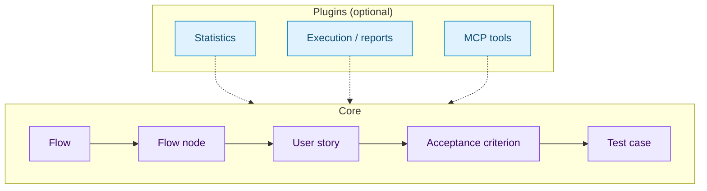

# Architecture

TestCanvas is a test manager built on the **ISTQB** methodology. It is made of
two parts:

- the **core**, which stores your test artefacts and keeps them coherent;
- optional **plugins**, which add extra features for each project.



## The ISTQB chain

Everything in TestCanvas follows one chain, from *what* must be tested to
*how* it is verified:

```text
Flow ──< Flow node ──< User story ──< Acceptance criterion ──< Test case
```

| Artefact | What it represents |
|----------|--------------------|
| **Flow** | A map of the application: its steps and states. It is the *test basis*. |
| **Flow node** | One step of the flow. A node can also point to another flow (a **sub-flow**). |
| **User story** | The behaviour expected at a flow node. |
| **Acceptance criterion** | A measurable condition the user story must meet (optionally in Given-When-Then form). |
| **Test case** | A test that verifies one acceptance criterion. |

Thanks to this chain, every test case can be traced back to the criterion, the
user story and the step of the application it covers.

## Collections

Flows are grouped in **collections** (folders, which can be nested).
Collections are also where access is granted: a user can read or edit a flow
only if they have access to its collection. See
[Collection permissions](../administration/collection-permissions.md).

## UIDs

Every artefact has a **UID**: a short, stable identifier that does not change
between environments or re-imports. Use the UID whenever you need to refer to
an artefact, for example from a plugin or an external tool.

Artefacts also have a **code** (e.g. `US-01`, `AC-01.1`, `TC-01.1.1`). A code
is a readable label for traceability, not an identifier: the same user story
code can appear more than once, for example in a copied flow. Acceptance
criterion codes are unique only inside their user story, and test case codes
only inside their acceptance criterion.

## Plugins

The core covers the ISTQB chain. Anything else is project-specific and is
added through plugins, for example:

- **statistics** — coverage and quality metrics;
- **execution / reporting** — links test cases to a test toolchain (e.g.
  Cucumber, Allure) and stores run results;
- **MCP tools** — automation and AI-assistant access, tailored per client.

Plugins are installed and removed without changing the core. They can add
pages, a link in the navbar and small widgets on the core pages.

Want to build one? Start from the [Plugin quickstart](../plugins/quickstart.md).

