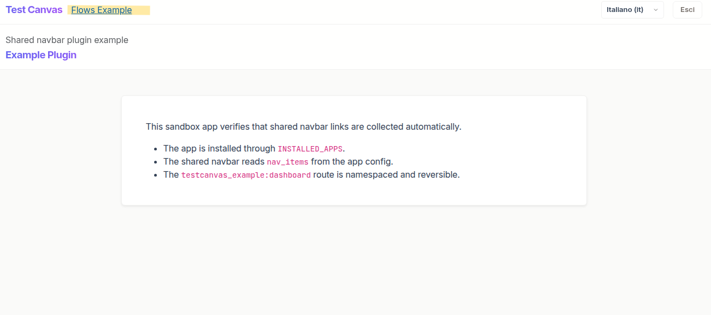

# How to Add a Django App to the Shared Navbar

This guide explains how to make any Django app appear in the shared TestCanvas navbar.

It is designed to be simple, practical, and copy-paste friendly.

## Goal

When an app is installed in `INSTALLED_APPS`, it can declare its own navbar links.
The shared collector automatically reads those declarations and renders them in the navbar.

This means:
- no hardcoded plugin links in the core template,
- no core template edits when adding/removing apps,
- consistent sorting and permission-based visibility.

## Prerequisites

Before adding links:
- your app is a valid Django app,
- your app config class is in `INSTALLED_APPS`,
- your app URL names are namespaced and reversible,
- the project registers the context processor
  `testcanvas.context_processors.app_context` in
  `TEMPLATES[0]["OPTIONS"]["context_processors"]` (it is the navbar
  collector; without it the navbar has no links and no error is raised).

New to plugins? Start from the [Plugin quickstart](plugin-quickstart.md).

## Step 1 - Add the app to `INSTALLED_APPS`

In `<your_project>/settings.py`:

```python
INSTALLED_APPS = [
    # ... existing apps ...
    "testcanvas_example.apps.TestcanvasExampleConfig",
]
```

If the app is not installed, the collector cannot see it.

## Step 2 - Declare navbar items in the app `AppConfig`

Create or update `testcanvas_example/apps.py`:

```python
from django.apps import AppConfig


class TestcanvasExampleConfig(AppConfig):
    default_auto_field = "django.db.models.BigAutoField"
    name = "testcanvas_example"
    label = "testcanvas_example"

    nav_items = [
        {
            "label": "Example",
            "url_name": "testcanvas_example:dashboard",
            "icon": "",
        }
    ]
```

Required fields per item:
- `label` (visible text)
- `url_name` (namespaced URL for `reverse()`)

Optional fields:
- `icon`
- `permission` (Django permission codename)

> ⚠️ **Replace the example values.** Do not leave `testcanvas_example:dashboard`
> (or any other placeholder) in your `nav_items`. If the `url_name` cannot be
> reversed, the link is **silently skipped**: no error, no warning, no log — the
> button simply does not appear. See [Defensive Behavior](#defensive-behavior-important).

> ℹ️ **About `icon`.** The value is rendered as **plain text** inside
> `<span class="app-navbar__icon">`, before the label. Use a short text or an
> emoji (e.g. `"🔌"`). CSS icon classes (e.g. `"bi bi-plug"`) and HTML markup are
> **not** supported: they would be shown literally (HTML is escaped). Leave it
> empty or omit it for a text-only link.

## Step 3 - Define app URLs with namespace

In `testcanvas_example/urls.py`:

```python
from django.urls import path
from .views import dashboard

app_name = "testcanvas_example"

urlpatterns = [
    path("", dashboard, name="dashboard"),
]
```

The `url_name` in `nav_items` must match this namespace and route name.

## Step 4 - Include app URLs in project routes

In `<your_project>/urls.py`:

```python
from django.urls import include, path

urlpatterns = [
    # ... existing routes ...
    path("example/", include("testcanvas_example.urls")),
]
```

## Step 5 - Optional: Add app ordering in settings

Ordering is controlled centrally by `AppConfig.label` in `<your_project>/settings.py`:

```python
NAVBAR_APP_ORDER = {
    "testcanvas": 10,
    "testcanvas_example": 20,
}
```

Sorting rules:
- if an app label is configured here, this value wins,
- ties use silent alphabetical order by `AppConfig.label`,
- apps not configured are sorted alphabetically by `AppConfig.label`,
- if the map is empty, all apps are alphabetical by `AppConfig.label`.

## Step 6 - Optional: Permission-based visibility

### Static permission on `nav_items`

```python
nav_items = [
    {
        "label": "Example",
        "url_name": "testcanvas_example:dashboard",
        "permission": "testcanvas_example.view_dashboard",
    }
]
```

If the user does not have the permission, the link is hidden.

### Dynamic links with `get_nav_items(request)`

Use this when visibility or labels depend on the request/user.

```python
from django.apps import AppConfig


class TestcanvasExampleConfig(AppConfig):
    default_auto_field = "django.db.models.BigAutoField"
    name = "testcanvas_example"
    label = "testcanvas_example"

    def get_nav_items(self, request):
        if not request.user.has_perm("testcanvas_example.view_dashboard"):
            return []

        return [
            {
                "label": "Example",
                "url_name": "testcanvas_example:dashboard",
            }
        ]
```

If both `get_nav_items` and `nav_items` exist, the dynamic method is used.

## Step 7 - Add a simple function-based view and template

In `testcanvas_example/views.py`:

```python
from django.contrib.auth.decorators import login_required
from django.shortcuts import render


@login_required
def dashboard(request):
    """Render the example plugin dashboard page."""
    return render(request, "testcanvas_example/dashboard.html")
```

In `testcanvas_example/templates/testcanvas_example/dashboard.html`:

```django


Example · TestCanvas
Example Plugin


<p>This page is reachable from the shared navbar.</p>

```

Why this matters:
- `testcanvas/bases/base_page.html` already includes the shared TestCanvas layout,
  including the top navigation bar, Bootstrap, HTMX and the TestCanvas theme.
- By extending this base template, your page automatically shows the collected
  navbar items (including your plugin link) without duplicating layout code.
- If you use a different base template, your route may still work but the shared
  navbar may not be visible.
- `content` is already placed in a centered `.wrap` container: do not add a
  Bootstrap `container` around it. Choose the width with the `wrap_class`
  block instead.

Blocks, CSS order and styling rules:
[Plugin templates and theming](plugin-templates-and-theming.md).



## Visibility: Authenticated Users Only

The shared navbar belongs to the main TestCanvas application, which is
reachable only after login. For this reason the collector returns **no links
for anonymous users**: every navbar item, including yours, is visible only to
authenticated users. This is by design.

Consequences:
- you do not need to add a login check just to hide a link from anonymous users;
- use `permission` or `get_nav_items(request)` only for finer, per-user rules;
- a plugin page may still be public (no `@login_required`) — the page works, but
  anonymous visitors will not see the navbar link that leads to it.

## Defensive Behavior (Important)

The collector is intentionally defensive:
- if a `url_name` cannot be reversed, that link is skipped,
- one broken plugin link does not break the entire navbar.

This is what keeps plugin add/remove operations safe.

> ⚠️ **Silent fail.** A skipped link produces **no exception, no warning and no
> log entry**. The only symptom is that the button is missing from the navbar.
> Typical causes: a placeholder `url_name` copied from this guide, a missing
> `app_name` in `urls.py`, a typo in the route name, app URLs not included in
> `<your_project>/urls.py`, or a `permission` the user does not have.
> Always verify your link with the test shown in
> [How to Test Your Navbar Link](#how-to-test-your-navbar-link).

## Quick Validation Checklist

- [ ] App config class is listed in `INSTALLED_APPS`.
- [ ] `testcanvas.context_processors.app_context` is in the template context processors.
- [ ] `AppConfig.label` is set and unique.
- [ ] `nav_items` or `get_nav_items(request)` is defined.
- [ ] Every `url_name` is namespaced and reversible.
- [ ] App URLs are included in `<your_project>/urls.py`.
- [ ] Optional: app label is added to `NAVBAR_APP_ORDER`.
- [ ] Optional: permission rules are correct.
- [ ] A navbar test confirms the link is collected (failures are silent).

## Troubleshooting

### Link does not appear
- Remember failures are silent: run the test in
  [How to Test Your Navbar Link](#how-to-test-your-navbar-link).
- Check you are logged in (anonymous users never see navbar links).
- Check `testcanvas.context_processors.app_context` is registered in settings.
- Check app is in `INSTALLED_APPS` with the correct AppConfig path.
- Check `url_name` matches `app_name:name` exactly.
- Check user permissions if `permission` is set.
- Check for typos in `AppConfig.label` when using `NAVBAR_APP_ORDER`.

### Wrong position in navbar
- Confirm `NAVBAR_APP_ORDER` contains the expected app label.
- If missing, the app is sorted alphabetically by `AppConfig.label`.
- If multiple apps share the same numeric order, tie-break is alphabetical.

### App removed but old link still expected
- Ensure the app is fully removed from `INSTALLED_APPS`.
- The collector only reads currently installed apps.

## Minimal Example Summary

For most plugins, this is enough:
1. add app config to `INSTALLED_APPS`,
2. define `label` and `nav_items` in `apps.py`,
3. define namespaced URL,
4. include app URLs in project `urls.py`.

The shared navbar picks it up automatically.

## How to Test Your Navbar Link

Because broken links are skipped silently, add a small test to your app.
The collector is the context processor
`testcanvas.context_processors.plugin_navbar(request)`: it returns
`{"nav_links": [{"label", "url", "icon", "active"}, ...]}` already filtered and
sorted, so you can call it directly with an authenticated request.

Create `testcanvas_example/tests/test_navbar.py`:

```python
"""Tests for the navbar link contributed by testcanvas_example."""

from django.contrib.auth import get_user_model
from django.contrib.auth.models import AnonymousUser
from django.test import RequestFactory, TestCase
from django.urls import reverse
from testcanvas.context_processors import plugin_navbar


class ExampleNavbarLinkTests(TestCase):
    """Check that the plugin link is collected and resolvable."""

    def setUp(self):
        """Build an authenticated request (the navbar is login-only)."""
        self.request = RequestFactory().get("/")
        self.request.user = get_user_model().objects.create_user(
            username="navbar-user", password="pwd"
        )

    def test_link_is_collected(self):
        """The link is present and points to the expected URL."""
        links = plugin_navbar(self.request)["nav_links"]
        example = [link for link in links if link["label"] == "Example"]

        self.assertEqual(len(example), 1)
        self.assertEqual(example[0]["url"], reverse("testcanvas_example:dashboard"))

    def test_anonymous_user_gets_no_links(self):
        """Anonymous users never see navbar links."""
        self.request.user = AnonymousUser()

        self.assertEqual(plugin_navbar(self.request)["nav_links"], [])
```

Run it:

```bash
python manage.py test testcanvas_example.tests.test_navbar
```

Tips:
- If `test_link_is_collected` finds 0 links, the `url_name` is not reversible
  or the permission check failed (see [Troubleshooting](#troubleshooting)).
- If you set `NAVBAR_APP_ORDER`, assert the link position too, e.g.
  `self.assertEqual(links[-1]["label"], "Example")`.
- If you use `permission`, add a test with a user without that permission and
  assert the link is absent.
- Manual check: log in, open any page that extends
  `testcanvas/bases/base_page.html`, and look for the button in the navbar.
